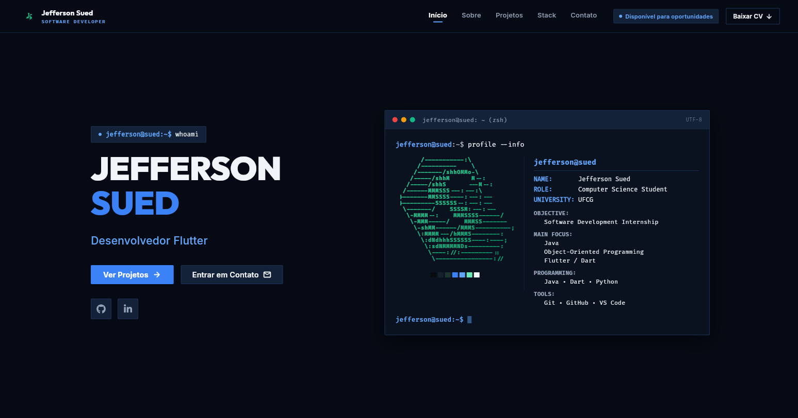

# Portfólio

Meu portfólio pessoal, desenvolvido em **Flutter Web**.


## Funcionalidades

- Barra de navegação que o visitante pode alternar entre lateral e topo
- Rolagem suave até cada seção
- Seções Sobre, Tecnologias, Projetos e Contato
- Projetos com link para o repositório no GitHub
- Formulário de contato com validação, enviado pelo Formspree
- Tema escuro com paleta de cores centralizada em `AppColors`

## Tecnologias

- Flutter e Dart
- Pacotes: `google_fonts`, `url_launcher`, `http`
- FVM para controle da versão do Flutter
- Formspree para o envio do formulário

## Estrutura do projeto

```
lib/
├── core/       # cores e constantes
├── models/     # classes de dados
├── data/       # conteúdo exibido no site
├── pages/      # páginas
├── sections/   # seções da página
└── widgets/    # componentes reutilizáveis
```

## Como rodar

Pré-requisitos: [Flutter](https://docs.flutter.dev/get-started/install)
(ou [FVM](https://fvm.app)) e um navegador Chrome ou Edge.

```bash
git clone https://github.com/jeffsued/meu_portfolio.git
cd meu_portfolio

# com FVM
fvm use stable
fvm flutter pub get
fvm flutter run -d chrome

# ou, com o Flutter instalado direto
flutter pub get
flutter run -d chrome
```

Para gerar a versão de produção:

```bash
flutter build web
```
## Autor

**Jefferson Sued**
[GitHub](https://github.com/jeffsued) · [LinkedIn](https://www.linkedin.com/in/jeffsued)
